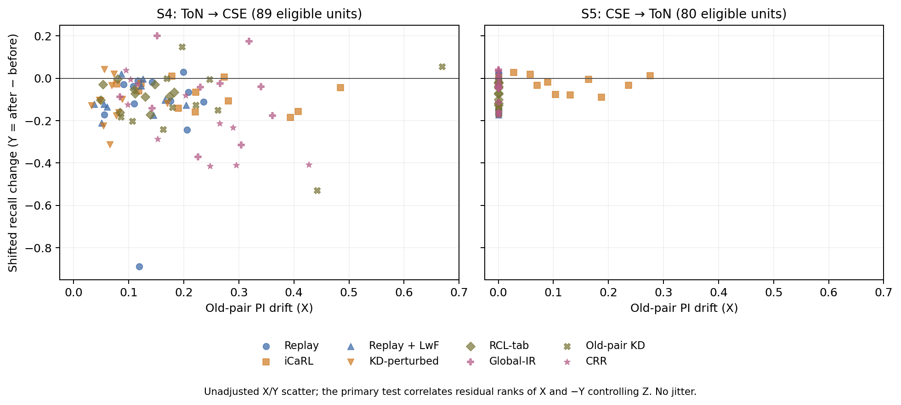

# Exp H confirmation extension — Work Order 19

Final experimental cutoff: 02:50 on 2026-10-14 (Asia/Kuala_Lumpur). **All 80 formal S4/S5 cells are complete. The registered Section 19.3 harm condition is not confirmed:** S4 partial Spearman is 0.031280 [−0.326731, 0.277332]; S5 is −0.127863 [−0.207726, −0.053242]. Controlled S1 passes, but neither new setting reaches the required positive ≥0.2 effect. This is a measurement-limited nonconfirmation, **not proof that drift is harmless**: the recall floor leaves mostly Normal units, and 70/80 eligible S5 units use the frozen constant-PI convention (details below). This is the single combined Section 19 report. No S4/S5 model, including smoke training, was run before the design below was written.

## 1. Scope and chronology

S1 was an exploratory discovery. Sections 19.2 and 19.3 were commissioned **after seeing S1**, so these are additional confirmation checks, not an analysis planned before the original experiment. The Section 17.6 intermediate verdict and the rejection of CRR are unchanged. Association is not a causal effect or an innovation claim. This is a bounded RQ1/RO1 measurement extension with descriptive RQ2 retention/cost evidence; it neither answers RQ3 nor satisfies the locked substantive-innovation completion requirement. UNSW/Malaya cleanup reruns remain required but lower priority; neither blocks this extension. No oversampling is used.

## 2. S1 robustness — existing observations only

The frozen Section 17 S1 data contain 440 units from 8 methods × 5 seeds. Applying the unchanged pre-transition shifted-recall floor (<0.2) excludes 161, leaving 279 units and all five seed clusters. Average ranks of X and −Y are residualized on an intercept, rank(Z), additive method dummies and additive old-class dummies. This is not a method-by-class interaction or a causal model. Each of 2,000 bootstrap draws resamples five entire seed clusters with replacement and recomputes ranks and regression; the interval is the 2.5/97.5 percentile interval (random seed 1705). All draws are identified.

| S1 model | Partial Spearman | 95% seed-cluster CI | ≥0.2 and CI excludes zero |
|---|---:|---|---|
| Original control Z only | 0.434180 | [0.351888, 0.502028] | Yes |
| Required control Z + method + old class | **0.285364** | **[0.241491, 0.349309]** | **Yes** |

The S1 component of the Section 19.3 conjunction passes. That alone does **not** confirm harm; the S4/S5 component below does not pass. With only five seed clusters, interval precision and external generalization remain limited.

### Per-method descriptive estimates

The requested per-method analysis controls Z. An additional old-class-adjusted column is shown to expose composition sensitivity, not to select a favorable variant. No per-method significance claim is made.

| Method | Eligible units | Control Z | Control Z + old class |
|---|---:|---:|---:|
| Replay | 37 | 0.471875 | 0.389191 |
| iCaRL | 33 | 0.200411 | 0.178122 |
| Replay + LwF | 37 | 0.588972 | 0.376966 |
| KD-perturbed | 37 | 0.384702 | 0.234324 |
| RCL-tab | 37 | 0.400584 | −0.059046 |
| Global-IR | 24 | 0.530143 | 0.578767 |
| Old-pair KD | 35 | 0.634135 | 0.489049 |
| CRR (unchanged rejected comparator) | 39 | 0.180762 | 0.045487 |

Positive counts: **8/8** controlling Z; **7/8** after the additional within-method class adjustment. Eligible class composition differs across methods.

### Leave one old class out

| Omitted old class | Remaining eligible units | Control Z | Control Z + method + class |
|---|---:|---:|---:|
| Normal | 159 | 0.516206 | **0.180254** |
| DoS | 185 | 0.431086 | 0.355898 |
| DDoS | 273 | 0.440557 | 0.287634 |
| Bruteforce | 228 | **0.265745** | 0.265207 |
| WebAttack | 271 | 0.452476 | 0.303008 |

Minimum: 0.265745 for Z-only, but **0.180254** for the fully adjusted analysis after removing Normal. Thus the signal stays positive in these deletions but does not uniformly retain the ≥0.2 threshold. Only five classes have eligible old-class transition units: Normal 120, DoS 94, DDoS 6, Bruteforce 51, WebAttack 8. Classes without such observations cannot supply a leave-one-class estimate. These deletions are descriptive, not additional decision gates.

## 3. S4/S5 design frozen before training

Frozen before new model execution on 2026-10-13. The exact machine-readable class/schema/cleanup/split specification in `ncd/exp_h_netflow.py` has SHA-256 **`7c0ca1ff207bc49db6131e90031dc3a2773a4638f2db0822b75766304144f96a`** (canonical sorted compact JSON). No class mapping, class order, endpoint, floor or threshold will be changed in response to model results. Data parsing may add only verified spelling aliases of the same declared labels, before training, and must fail on unknown labels rather than silently discard them.

Sources: the [UQ dataset authors' NetFlow-v2 description](https://staff.itee.uq.edu.au/marius/NIDS_datasets/), [NF-ToN-IoT-v2 official delivery](https://rdm.uq.edu.au/files/a4ad7080-ef9c-11ed-a964-b70596e96ad5), and [NF-CSE-CIC-IDS2018-v2 official delivery](https://rdm.uq.edu.au/files/ce5161d0-ef9c-11ed-827d-e762de186848). Cite Sarhan, Layeghy and Portmann, *Towards a Standard Feature Set for Network Intrusion Detection System Datasets*, 2022, DOI [10.1007/s11036-021-01843-0](https://doi.org/10.1007/s11036-021-01843-0). The official archive permits academic research with citation; it is not assumed to grant unrestricted commercial redistribution. Raw datasets and large weights stay local.

### Fixed common-family mapping

| Common family (fixed order) | NF-ToN-IoT-v2 | NF-CSE-CIC-IDS2018-v2 | Interpretation |
|---|---|---|---|
| Normal | Benign | Benign | Non-attack traffic |
| DoS | dos | DoS family, including the named DoS attack variants | Single-source denial-of-service family |
| DDoS | ddos | DDoS family, including named HOIC/LOIC variants | Distributed denial-of-service family |
| CredentialAttack | password | BruteForce family, including FTP/SSH brute force | Broad credential-attack family, **not identical attack implementations** |
| WebAttack | injection + xss | Web Attacks, SQL Injection, Brute Force -Web, Brute Force -XSS | Broad application-injection/web-attack family, **not identical subclass composition** |

Password in ToN includes brute-force or sniffing; consequently CredentialAttack is an explicitly chosen broader category, not an author-provided equivalence. WebAttack has heterogeneous subclass composition. No Backdoor↔Infiltration or Scanning↔Infiltration equivalence is assumed. ToN Backdoor, MITM, Ransomware and Scanning, and CSE Bot and Infiltration, are excluded from modeling but retained in the global conflict detection pass. No NF-UNSW training is added to S4/S5.

The raw schema is the same 43 NetFlow fields. Following the existing `src/data/nf_ton_iot_v2.py` identifier policy, both models omit source/destination IPv4 and source/destination L4 ports; **39 numeric features enter the models**, not 43. Label and Attack never enter X. Both sources must match the exact 43-column feature schema; there is no feature-alias alignment. Float32 representability/finite checks occur before grouping, signed zero is canonicalized, and exclusions are counted. No imputation from shifted data is permitted; the numeric scaler is fit on Task 0 source training only.

### Global cleanup and split (before caps or fitting)

1. Pool every raw file in each source, including supplied ToN train/test CSVs. The supplied split labels are not retained.
2. Compare complete canonical 39-feature float32 byte vectors across **both full sources**, excluding IPs, ports, labels and dataset identity from the key. Hash partitioning only accelerates grouping; full bytes determine equality.
3. For an identical feature group with more than one declared family label, remove the **entire** conflict group. Excluded attack types retain distinct labels in this check. Within-family subclass merging follows only the frozen table above.
4. Remove every remaining identical-feature group represented in **both** datasets from both sides. This symmetric exclusion avoids choosing one source as the winner and prevents direct exact overlap in either direction.
5. Retain one representative per remaining within-source feature group. Then retain only the five declared common families. Use deterministic feature-hash allocation (seed 42), approximately 80% training / 20% held out, separately counted per source/class.
6. Cap only training at 40,000 per class after cleanup and splitting, with deterministic selection. Keep **all** held-out observations, without class balancing, resampling or per-class caps. Each direction uses its own source holdout as ID and the other source's holdout as shifted test. Report actual sizes, duplicate/conflict removals and zero cross-view overlap checks.

S4 trains ToN and evaluates CSE shift; S5 reverses them. Class tasks are `[Normal, DoS] → [DDoS, CredentialAttack] → [WebAttack]`, retaining the two-classes-per-task CIC-style convention from Section 17. The final WebAttack class has no subsequent old-class transition and does not create a primary drift-harm unit. This yields six raw old-class transition units per cell, 240 per setting before the recall floor. The reciprocal directions share datasets and are **not independent external replications**.

Learners, frozen NSL-calibrated regularization, MLP training hyperparameters, PI instruments, seeds {1,2,3,4,42}, floor <0.2, seed-cluster bootstrap (2,000), and the Section 17.5 unit/method analyses are unchanged. Eight methods × five seeds × two settings = 80 formal cells. The same entry point must finish a one-seed, one-epoch, 64-rows/class end-to-end smoke before formal execution. Smoke values cannot support scientific claims. Checkpoint reuse is allowed only with matching configuration, source and prepared-data identities.

## 4. Completed S4/S5 results and confirmation decision

### Completed preparation and execution check

The two sources contain 35,834,204 raw rows (ToN 16,940,496; CSE 18,893,708). Preparation completed on 2026-10-13 in 361.52 seconds. It excluded 384 nonfinite/unrepresentable model-feature rows: ToN Benign 90 and MITM 41; CSE Benign 201 and DDoS-LOIC-UDP 52. No missing value was imputed from target data. The following accounting is over the remaining 35,833,820 rows:

| Cleanup quantity | Groups | Member rows |
|---|---:|---:|
| Conflicting mapped labels | 2,906 | 3,114,315 |
| Exact feature groups present in both sources | 3,655 | 5,953,429 |
| Union removed (the above categories overlap) | 5,595 | **6,399,536** |
| Additional within-source duplicate copies removed | — | **17,984,858** |
| Unique vectors retained before excluding non-common families | 11,449,426 | 11,449,426 |
| Non-common family vectors excluded after cleanup | 111,825 | 111,825 |
| Shared-family unique vectors available for splitting | **11,337,601** | **11,337,601** |

The union, duplicate copies and retained unique vectors sum exactly to the valid input count. Conflict and cross-source member rows must not be added separately. All eight saved arrays passed size/SHA-256 validation; raw input totals match both complete releases. Independent full-byte equality checks across the 2,600,150 saved rows found **zero within-view duplicate copies and zero overlap for all six pairs** of ToN/CSE train/holdout views. This is exact equality of the 39 canonical raw float32 features, not a claim about later standardization rounding. The full per-label and per-domain accounting is in `ncd/results/exp_h/section19/data_preparation.json` (SHA-256 `9157c7cb2cc4db2203245e8d7d3455f25d91964da332695c1d39e3cda1aa686e`), with the successful preparation log beside it.

| Domain | Training after the prespecified cap | Natural holdout (uncapped) | WebAttack train / holdout |
|---|---:|---:|---:|
| ToN | 200,000 | 488,083 | 40,000 / 222,879 |
| CSE | 132,021 | 1,780,046 | **217 / 49** |

CSE has only 266 distinct retained WebAttack vectors. This severe rarity and source/target composition difference are limitations, not reasons to oversample, change mapping or replace the holdout. The source cap removes training observations only; it never duplicates rare examples. WebAttack is the final task and is not a primary old-class transition endpoint, although its addition can affect earlier classes and it remains in prediction/retention summaries.

An initial preparation attempt stopped at a 256 MiB partition safety guard before model execution. Lossless per-chunk exact-key multiplicity compression fixed the high-frequency duplicate concentration without changing any cleanup rule; the original failure logs and source remain local. An independent expanded-versus-weighted check matched all removal counts and retained vectors in 205 cases. All 31 implementation tests passed. The same `run_exp_h_confirmation_local.ps1 -Smoke` entry then completed on the real prepared data: 16 cells, 96 transition rows, 80 retention rows and 48 checkpoints; exit 0 and empty stderr. Smoke uses at most 64 rows per class (only 49 CSE WebAttack holdout rows exist), one seed and one epoch; its analysis correctly remains **pending**, not scientific confirmation. Execution source: `562e65d0bb868e321bd2f97f571dfbe0e14e2b48`.

### Registered rule

**Harm confirmed** only if at least one of S4/S5 has primary partial Spearman ≥0.2 with its 95% CI excluding zero **and** S1 adjusted for method and class meets the same condition. Secondary PI and descriptive method correlations cannot replace a failed primary condition. If both S4 and S5 miss their condition, report **harm not confirmed**. A missing or unidentified required result remains pending, not a negative finding. If a new setting passes but S1 fails, the conjunction is not met and the discordance is reported explicitly; no threshold is changed. Causal harm or method effectiveness is not established by this rule.

### Unit-level estimates and sample sizes

X is old-pair PI drift; Y is shifted recall after minus before; Z is ID recall after minus before. The unchanged Section 17.5 estimator correlates residual average ranks of X and **−Y**, controlling an intercept and rank(Z). Each draw resamples all five seed clusters with replacement, preserving every method/transition/class within a selected seed, and recomputes ranks. Intervals are separate 95% percentile intervals, not a simultaneous or cross-setting interval. The frozen entry-point base seed is **1705**; the unchanged analyzer adds the setting index, hence the actual per-setting seeds are **S4=1705, S5=1706**. Neither seed nor estimator was retuned after seeing results.

| Component | Primary partial Spearman | 95% seed-cluster CI | ≥0.2 and CI excludes zero |
|---|---:|---|---|
| S1, Z + method + class | 0.285364 | [0.241491, 0.349309] | Yes |
| S4, ToN → CSE, Z only | **0.031280** | **[−0.326731, 0.277332]** | **No** |
| S5, CSE → ToN, Z only | **−0.127863** | **[−0.207726, −0.053242]** | **No: opposite direction** |

| Setting | Cells | Raw units | Floor excluded | Eligible units / composition | Seed clusters | Valid / requested draws |
|---|---:|---:|---:|---|---:|---:|
| S4 | 40 | 240 | 151 | 89: Normal 80, DDoS 9 | 5 | 2000 / 2000 |
| S5 | 40 | 240 | 160 | 80: Normal only | 5 | 2000 / 2000 |

There are no invalid numeric units or undefined bootstrap draws under the frozen scalar metric. S4 eligible counts by seeds 1/2/3/4/42 are 19/17/18/18/17; S5 has 16 each. DoS and CredentialAttack supply no eligible units in either direction. Floor exclusion is severe: 62.9% in S4 and 66.7% in S5. These results cannot establish a general attack-class effect.

Secondary self-margin PI: S4 rho 0.044973 [−0.233331, 0.215756]; S5 rho −0.132324 [−0.216473, −0.076505]. These are secondary checks only and do not replace the primary gate.

**Section 19.3 decision: harm not confirmed under the registered measurement.** Both new settings miss the positive primary condition despite controlled S1 passing. S4's interval is broad, so it does not exclude a positive association of practical size. S5's negative association is computationally identified but strongly measurement-limited as explained below. Neither result proves absence of harm, causal protection from drift, or efficacy of any preservation method. The reciprocal datasets do not provide independent replications, and five seed clusters limit interval stability. The Section 17/18 historical conclusions and CRR rejection remain unchanged.

### Descriptive eight-method retention

Mean X uses floor-eligible transition units. Retention is shifted recall final/best for classes represented in those eligible units, averaged across classes within each seed and then equally across five seeds; repeated transitions do not duplicate a class endpoint. Thus this is **not all-class retention**: S5 is Normal-only, and S4 class composition varies by method. The complete 400 class/seed retention rows remain available separately.

| Method | S4 mean X | S4 mean retention | S5 mean X | S5 mean retention |
|---|---:|---:|---:|---:|
| Replay | 0.147338 | 0.743727 | 0.000000 | 0.823351 |
| iCaRL | 0.247452 | 0.795208 | 0.134365 | 0.929714 |
| Replay + LwF | 0.105277 | 0.739153 | 0.000000 | 0.823861 |
| KD-perturbed | 0.071861 | 0.718023 | 0.000000 | 0.822722 |
| RCL-tab | 0.114567 | 0.818707 | 0.000000 | 0.857607 |
| Global-IR | 0.242503 | 0.745129 | 0.000000 | 0.923107 |
| Old-pair KD | 0.249135 | 0.638362 | 0.000000 | 0.814906 |
| CRR (rejected comparator) | 0.208303 | 0.525698 | 0.000000 | 0.816286 |

Eight-point Spearman between mean old-pair drift and retention: **S4 −0.023810; S5 +0.577350**. Self-margin alternatives: S4 +0.142857; S5 +0.577350. These descriptive associations are not additional confirmation tests; S5's tied zero-drift means make its ranking particularly uninformative about general within-method behavior.

### Constant-PI measurement limitation and scatter

In S5, all 70 eligible units from the seven non-iCaRL methods have all-zero before/after PI vectors. The frozen `spearman` helper in `ncd/run_crr_real_sequence.py` returns correlation 1 when its rank denominator is ≤1e−12 and the vectors are `allclose`, hence drift 0. The 140 old-pair comparisons behind these units use that convention (280 strictly all-zero pair vectors); iCaRL's 20 comparisons are nonconstant. The corresponding self-margin comparisons have 140 all-zero vectors. None of S4's 187 eligible old-pair comparisons has a constant vector. A zero produced by this convention is **not an identified rank correlation between informative feature-importance vectors**, nor proof of preserved feature reliance. The pooled scalar test still has variation from iCaRL and is computationally identified; the quoted nonconfirmation must retain this limitation. Sample checkpoint weights were finite and nonzero, with normal ID recall; the zero-vector cause has not been independently localized by a forward-pass diagnosis. No constant-vector filtering, new floor, alternative estimator, or retraining was introduced after results.

The scatter shows X versus **Y**, not −Y and not residualized ranks; the statistical table applies the registered control. Both panels use identical axes and no jitter. Marker shape distinguishes the eight methods in addition to color. All 89/80 eligible observations are plotted; the 70 zero-X S5 observations overlap at zero. Four identifiers are excluded consistently: every plotted row and every archived PI vector has 39 numeric features. Coordinates, eligibility and the rendered figure were checked against the final raw result.

## 5. Reproducibility and limits

S1 input: `ncd/results/exp_h/section17/registered/exp_h_result.json`, SHA-256 `4b2724122bc5b3ddcfd1a2b6e02601b73c763c14a88c05d40ca3e9d6e41b0e7b`; experiment source `a8b90215a0ad369a11a5cbb07b2176e9d821f5f3`. The Section 19 work-order base is `539728e6a7161e840a27859ca0d8455615338d71`; the reanalysis separately records its script hash, command and log. Machine-readable estimates, all 2,000 draws, per-method/leave-one-class outputs and the run log are under `ncd/results/exp_h/section19/s1_robustness/`.

Reproduce S1: `python ncd/analyze_exp_h_robustness.py --input-dir ncd/results/exp_h/section17/registered --output-dir <new-output-directory> --bootstrap 2000 --bootstrap-seed 1705`. Seven numerical/contract unit tests passed. The original Z-only result and CI reproduce the frozen Section 17 values. An independent full-dummy/pseudoinverse implementation also recomputed both point estimates, all 2,000 bootstrap draws and all descriptive subsets; maximum absolute discrepancy was 6.66×10⁻¹⁶.

Formal S4/S5 ran locally on RTX 4060 Ti from 19:06 on 2026-10-13 through 02:50 on 2026-10-14 using source `562e65d0bb868e321bd2f97f571dfbe0e14e2b48`: `python -I ncd/run_exp_h_confirmation.py --config ncd/configs/exp_h_section19.json --cleaned-data-root <prepared-cache-directory> --output-dir ncd/results/exp_h/section19/local_v1`. Source identity remains this execution commit despite later reporting/plotting commits. No formal retry or HPC run was needed. The detached launcher did not retain a numeric OS exit code; completion is supported by the final matrix marker, `execution_status=complete`, terminated original process/wrapper, empty stderr and full output reconciliation, not an invented exit receipt.

Independent integrity checks reconcile **80 unique cells, 240 local checkpoints, 480 transition rows (240/setting), 400 retention rows, 160 PI archives and 3,200 finite 39-feature vectors**. Aggregate rows/CSV and all cell shards agree. All eight source-file hashes match the execution commit; config, frozen calibration, mapping, preparation receipt and eight actual cache files match their recorded hashes. Large original CSV/ZIP files were not rehashed again at finalization; their preparation bindings and the actual saved cache were checked. Each cell's cumulative training cost agrees with its final checkpoint: total **2,992.512272 seconds**. The sum of cell attempt elapsed times is 27,828.11 seconds, dominated by evaluation/PI and distinct from training time; neither quantity includes data preparation, smoke or failed preparation effort. Preparation/smoke and preserved failed-attempt logs are separate, not hidden inside these costs.

An independent centered-rank/projection calculation reproduced both primary/secondary point estimates, both 2,000-draw intervals and the eight-method summaries; maximum statistical discrepancy was 8.33×10⁻¹⁷. This reused raw observations, not the shared estimator as its independent proof. Formal raw JSON, CSV, cell metadata, small PI arrays, stdout-equivalent `run.log`, empty `stderr.log`, analysis and scatter are preserved under `ncd/results/exp_h/section19/local_v1/`. Checkpoints and raw datasets stay local and are not included in either repository delivery. Cell checkpoint references therefore describe local reproducibility products, not downloadable weights.

Final raw result SHA-256: `f9b4c88f0eb314564e50960f8dd9dcb16f5ce4fa033815d048bffc6d9f5faa67`; final analysis SHA-256: `a882e87b8b95013b2d4657286f5cd6aeaea9d3b22bf1a0440efad4869ce5af6c`. The analysis binds the final raw hash. Recreate the figure without training: `python -I ncd/plot_exp_h_confirmation.py --input ncd/results/exp_h/section19/local_v1/exp_h_result.json --output <figure.png>`.

The downloaded official CSE archive has SHA-256 `ad6307995d08ff8825d0193d5a1cfa61cf3dc4c6f223962ba3762a7775b5dc24` (612,059,380 bytes). The pre-training report version is preserved in commit `562e65d0bb868e321bd2f97f571dfbe0e14e2b48` (report SHA-256 `8b057f79d141b25752129d654e45e9e8a29c7edb60e05f189e27f2a8327ce5a4`); preparation records that version, not later status edits. Preparation source SHA-256 is `7c4a9fd22d433aaa65e0209083ca589648a442d0bd51b3d399b3a6ae69ea4af2`. Completed S4/S5 estimates replace pending entries without changing the frozen design. S1 still inherits Section 18 limitations; this new cleanup does not retroactively clean historical results or discharge the separate UNSW/Malaya obligations.

**Next:** the owner decides the research direction after this qualified nonconfirmation; no target change or new mechanism is inferred. Section 19.4 UNSW-NB15/Malaya global-deduplication and conflict-removal reruns, with old/new results side by side, remain explicitly **pending** at lower priority. The broader research project is not complete.
