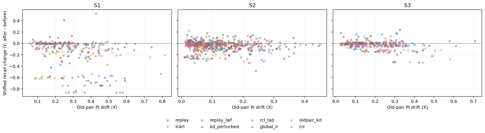

# Exp H: dependency drift under distribution shift

Completed 13 October 2026, 17:57 MYT. **Section 17.6 decision: intermediate.** All 120 planned cells finished (3 settings × 8 methods × 5 seeds). Only S1 meets the single-setting threshold of partial Spearman ≥ 0.2 with a positive 95% CI. Thus the registered requirement of at least two settings is not met. The “harm not supported” condition is not met either. The project owner decides the next step; no new mechanism or rerun is initiated here.

This is **pre-cleanup, observational evidence**, qualified by the [Section 18 data-quality audit](DATA_QUALITY_AUDIT_20261013.md). It does not prove that drift causes harm, establish an innovation, reverse CRR's rejection, or complete the broader RQ1–RQ3 programme. PI is the instrument in this experiment; it does not replace the project's separate SHAP requirement.

## 1. Unit-level result (Section 17.5)

A unit is (setting, method, seed, transition, old class). X is old-pair PI drift; Y is shifted recall after minus before; Z is ID recall after minus before. The estimate is the correlation of average-rank residuals of X and −Y after regression on an intercept and rank(Z). The secondary X uses class-self-margin PI drift.

| Setting | Primary partial rho | 95% CI | Secondary partial rho | 95% CI | Meets single-setting harm threshold |
|---|---:|---|---:|---|---|
| S1 | 0.4342 | [0.3519, 0.5020] | 0.3378 | [0.2931, 0.3951] | Yes |
| S2 | 0.1503 | [0.0555, 0.2225] | 0.1061 | [0.0377, 0.1657] | No |
| S3 | 0.1053 | [0.0463, 0.1757] | 0.1471 | [0.0617, 0.2309] | No |

Each setting uses 2,000 bootstrap draws of five entire seed clusters with replacement (seeds 1, 2, 3, 4, 42). All methods, classes and transitions in a sampled seed remain together; ranks are recomputed. RNG seeds are 1705/1706/1707 for S1/S2/S3. All draws were defined. Intervals are unadjusted, separate 95% percentile intervals. **There are five seed resampling clusters, not 1,192 independent observations.** The small number of clusters limits interval stability and generalization.

The predeclared decision requires ≥2 settings with primary rho ≥0.2 and same-direction CIs excluding zero. Only S1 qualifies. All three primary rhos exceed 0.1 and all three CIs exclude zero, so neither negative endpoint (“all rho <0.1” or “all CIs include zero”) applies. The secondary measure and descriptive method correlations do not replace this decision rule.

## 2. Method-level result (descriptive)

Eight existing methods were reused without retuning. X means use floor-eligible old-class transition units. Retention is final/best shifted recall, averaged across matched old classes within each seed and then across seeds. Only classes represented by floor-eligible drift units enter this summary. Consequently eligible class coverage can differ by method; this is not an overall performance ranking or a new confirmatory test.

| Setting | Method | Mean old-pair X | Mean self-margin X | Mean shifted retention | Eligible drift units |
|---|---|---:|---:|---:|---:|
| S1 | replay | 0.3209 | 0.3211 | 0.6340 | 37 |
| S1 | icarl | 0.3356 | 0.3458 | 0.4589 | 33 |
| S1 | replay_lwf | 0.2467 | 0.2407 | 0.6010 | 37 |
| S1 | kd_perturbed | 0.2536 | 0.2296 | 0.6405 | 37 |
| S1 | rcl_tab | 0.2905 | 0.2828 | 0.7470 | 37 |
| S1 | global_ir | 0.3582 | 0.3568 | 0.5397 | 24 |
| S1 | oldpair_kd | 0.2493 | 0.2836 | 0.7026 | 35 |
| S1 | crr | 0.2731 | 0.3181 | 0.5533 | 39 |
| S2 | replay | 0.1807 | 0.1856 | 0.7464 | 80 |
| S2 | icarl | 0.1188 | 0.1343 | 0.7303 | 75 |
| S2 | replay_lwf | 0.1039 | 0.0955 | 0.7918 | 77 |
| S2 | kd_perturbed | 0.1012 | 0.0821 | 0.7922 | 76 |
| S2 | rcl_tab | 0.1339 | 0.1176 | 0.7783 | 79 |
| S2 | global_ir | 0.0917 | 0.0881 | 0.8869 | 57 |
| S2 | oldpair_kd | 0.0873 | 0.0748 | 0.8038 | 74 |
| S2 | crr | 0.0924 | 0.1084 | 0.7362 | 73 |
| S3 | replay | 0.2590 | 0.2629 | 0.8934 | 43 |
| S3 | icarl | 0.2148 | 0.2420 | 0.8592 | 45 |
| S3 | replay_lwf | 0.1774 | 0.1592 | 0.9000 | 40 |
| S3 | kd_perturbed | 0.1689 | 0.1573 | 0.8983 | 40 |
| S3 | rcl_tab | 0.1918 | 0.1813 | 0.8792 | 40 |
| S3 | global_ir | 0.1824 | 0.1937 | 0.9481 | 32 |
| S3 | oldpair_kd | 0.2030 | 0.1784 | 0.8728 | 42 |
| S3 | crr | 0.2012 | 0.2176 | 0.8778 | 40 |

All method retention estimates include 5/5 seeds. Eight-point Spearman correlations of mean drift versus retention (old-pair / self-margin) are: S1: -0.5000 / -0.6667; S2: -0.6190 / -0.8095; S3: -0.6667 / -0.3571. Negative signs mean greater drift is associated with lower retention.

## 3. Sample sizes, exclusions and actual scope

Counts are the actual fixed evaluation views, not the full uncapped raw populations.

| Setting | Training rows | ID rows | Shift rows | Raw units | Floor excluded | Included units |
|---|---:|---:|---:|---:|---:|---:|
| S1: CIC-2017 → CIC-2018 | 610,447 | 146,109 | 60,198 | 440 | 161 | 279 |
| S2: Malaya cross-capture | 29,098 | 7,274 | 6,590 | 800 | 209 | 591 |
| S3: NSL-KDD → KDDTest-21 | 125,973 | 22,544 | 11,850 | 360 | 38 | 322 |

Exclude a unit only when its pre-transition shifted recall is **<0.2**; exactly 0.2 is retained. Total: 1,600 raw, 408 floor-excluded, 1,192 included, zero invalid numeric units, zero malformed identities. All settings retain eight methods and five seed clusters. The 880 stored retention endpoints include all evaluated class/seed/method endpoints; the matched descriptive analysis uses the eligible subset.

- **S1:** 8 training families, 7 with target data (no PortScan in target). Actual old-class transition evidence covers Normal, DoS, DDoS, Bruteforce and WebAttack. Botnet/Infiltration are introduced last and have no later old-class transition. After the floor rule, only 6 DDoS and 8 WebAttack units remain. The existing family caps alter the original distribution. Rare subclasses are not oversampled.
- **S2:** 21 source training captures and 10 held captures are disjoint. Original training pool 36,372 is divided into 29,098 fit and 7,274 ID rows by deterministic full-feature-group greedy allocation (seed 42, approximately 20% per-class ID target), not random row splitting. Of 10,370 held-capture rows, 3,780 matching the original training pool were excluded, leaving 6,590. Ten application classes have shift data; eight appear as old classes, but floor exclusion removes Slack and TeamViewer entirely, leaving six. TeamViewer has only 37 shift rows. This is application recognition, **not attack-class NIDS evidence**.
- **S3:** KDDTest-21 is the difficulty <21 subset of the same KDDTest+ used for ID evaluation, **not an independent external dataset**. Z uses the full ID test containing this subset. Old-class evidence covers Normal, DoS, Probe and R2L; U2R is last-introduced.

### Scatter: X versus Y



Each dot is a retained old-class transition unit, colored by method. The plotted vertical axis is Y (after minus before); the statistical endpoint uses −Y controlling Z. Y is a recall proportion (0.1 = 10 percentage points). Y limits are shared; X limits are independently fitted by panel and must not be used for visual slope comparisons. This plot is unadjusted for Z and is not the partial correlation itself.

## 4. Data-quality qualifications that remain open

Section 18 keeps the threshold unchanged: total train/test exact overlap ≥5%, or any class ≥20%, requires global feature deduplication **before splitting** and removal of conflicting-label groups, with applicable old/new runs reported side by side. **No such rerun was authorized or performed in this audit-only continuation. No oversampling or new test resampling was added.**

- **NSL-KDD / S3:** keep under the registered threshold. Full test overlap is 2.945%; Test-21 has 529/11,850 matches (4.464%). “Keep” does not mean zero leakage or independent shift evidence.
- **Malaya / S2:** the original split has 36.451% overlap, triggering the dataset-level **deduplicate-and-rerun obligation**. The audited fit–ID and fit–shift views have zero exact overlap, but the fit view still has 5,366 conflicting-label rows in 40 feature groups. The current S2 result is not quality-corrected and does not waive the rerun requirement.
- **CIC / S1:** actual frozen feature-hash-group train/ID splits have zero cross-split overlap, so keep under Section 18. Aligned source-to-shift overlap is 46/60,198 (0.0764%). Internal train duplication remains (CIC17 18.767%; CIC18 32.984%), as do label conflicts. Original-release caches were used, not relabeled corrected datasets. Audit coverage includes all 426 CIC18 cached shards from ten raw-file sources, but one original raw CSV is absent. Semantic feature alignment cannot remove FlowMeter version, collection or labeling differences.
- **UNSW-NB15:** not an Exp H setting, but the earlier 10.374% total overlap and individual classes above 20% retain its separate Section 18 real-sequence rerun obligation. Nothing in Exp H changes the final primary CRR rejection.

The formal outcome is therefore **intermediate on the completed, pre-cleanup matrix**, not general proof of harm and not proof of no harm. Floor exclusions also limit the claim to classes/checkpoints that initially achieved recall ≥0.2.

## 5. Feature alignment

S1 uses 77 features: 27 identical names and 50 semantic aliases, with two excluded unmatched fields shown below. S2 retains the same 77 numeric features in fit/ID/shift and excludes five identifier fields. S3 uses the same 41 raw inputs and 116 encoded model inputs; labels and difficulty are not features. Scaling is fit on Task 0 training and reused. Full alignment rows for every setting are also stored in the unchanged published analysis JSON.

| Setting | Input dimensions | Alignment rule | Exclusions |
|---|---|---|---|
| S1 | 77 | 27 same-name + 50 CICFlowMeter aliases | source Fwd Header Length.1; target Protocol |
| S2 | 77 | Identical numeric names across held captures | five identifier fields listed in analysis JSON |
| S3 | 41 raw → 116 encoded | Same NSL schema and frozen encoding | label and difficulty are not inputs |

### Complete S1 mapping

| CIC-2017 feature | CIC-2018 feature | Action |
|---|---|---|
| Destination Port | Dst Port | aligned |
| Flow Duration | Flow Duration | aligned |
| Total Fwd Packets | Tot Fwd Pkts | aligned |
| Total Backward Packets | Tot Bwd Pkts | aligned |
| Total Length of Fwd Packets | TotLen Fwd Pkts | aligned |
| Total Length of Bwd Packets | TotLen Bwd Pkts | aligned |
| Fwd Packet Length Max | Fwd Pkt Len Max | aligned |
| Fwd Packet Length Min | Fwd Pkt Len Min | aligned |
| Fwd Packet Length Mean | Fwd Pkt Len Mean | aligned |
| Fwd Packet Length Std | Fwd Pkt Len Std | aligned |
| Bwd Packet Length Max | Bwd Pkt Len Max | aligned |
| Bwd Packet Length Min | Bwd Pkt Len Min | aligned |
| Bwd Packet Length Mean | Bwd Pkt Len Mean | aligned |
| Bwd Packet Length Std | Bwd Pkt Len Std | aligned |
| Flow Bytes/s | Flow Byts/s | aligned |
| Flow Packets/s | Flow Pkts/s | aligned |
| Flow IAT Mean | Flow IAT Mean | aligned |
| Flow IAT Std | Flow IAT Std | aligned |
| Flow IAT Max | Flow IAT Max | aligned |
| Flow IAT Min | Flow IAT Min | aligned |
| Fwd IAT Total | Fwd IAT Tot | aligned |
| Fwd IAT Mean | Fwd IAT Mean | aligned |
| Fwd IAT Std | Fwd IAT Std | aligned |
| Fwd IAT Max | Fwd IAT Max | aligned |
| Fwd IAT Min | Fwd IAT Min | aligned |
| Bwd IAT Total | Bwd IAT Tot | aligned |
| Bwd IAT Mean | Bwd IAT Mean | aligned |
| Bwd IAT Std | Bwd IAT Std | aligned |
| Bwd IAT Max | Bwd IAT Max | aligned |
| Bwd IAT Min | Bwd IAT Min | aligned |
| Fwd PSH Flags | Fwd PSH Flags | aligned |
| Bwd PSH Flags | Bwd PSH Flags | aligned |
| Fwd URG Flags | Fwd URG Flags | aligned |
| Bwd URG Flags | Bwd URG Flags | aligned |
| Fwd Header Length | Fwd Header Len | aligned |
| Bwd Header Length | Bwd Header Len | aligned |
| Fwd Packets/s | Fwd Pkts/s | aligned |
| Bwd Packets/s | Bwd Pkts/s | aligned |
| Min Packet Length | Pkt Len Min | aligned |
| Max Packet Length | Pkt Len Max | aligned |
| Packet Length Mean | Pkt Len Mean | aligned |
| Packet Length Std | Pkt Len Std | aligned |
| Packet Length Variance | Pkt Len Var | aligned |
| FIN Flag Count | FIN Flag Cnt | aligned |
| SYN Flag Count | SYN Flag Cnt | aligned |
| RST Flag Count | RST Flag Cnt | aligned |
| PSH Flag Count | PSH Flag Cnt | aligned |
| ACK Flag Count | ACK Flag Cnt | aligned |
| URG Flag Count | URG Flag Cnt | aligned |
| CWE Flag Count | CWE Flag Count | aligned |
| ECE Flag Count | ECE Flag Cnt | aligned |
| Down/Up Ratio | Down/Up Ratio | aligned |
| Average Packet Size | Pkt Size Avg | aligned |
| Avg Fwd Segment Size | Fwd Seg Size Avg | aligned |
| Avg Bwd Segment Size | Bwd Seg Size Avg | aligned |
| Fwd Avg Bytes/Bulk | Fwd Byts/b Avg | aligned |
| Fwd Avg Packets/Bulk | Fwd Pkts/b Avg | aligned |
| Fwd Avg Bulk Rate | Fwd Blk Rate Avg | aligned |
| Bwd Avg Bytes/Bulk | Bwd Byts/b Avg | aligned |
| Bwd Avg Packets/Bulk | Bwd Pkts/b Avg | aligned |
| Bwd Avg Bulk Rate | Bwd Blk Rate Avg | aligned |
| Subflow Fwd Packets | Subflow Fwd Pkts | aligned |
| Subflow Fwd Bytes | Subflow Fwd Byts | aligned |
| Subflow Bwd Packets | Subflow Bwd Pkts | aligned |
| Subflow Bwd Bytes | Subflow Bwd Byts | aligned |
| Init_Win_bytes_forward | Init Fwd Win Byts | aligned |
| Init_Win_bytes_backward | Init Bwd Win Byts | aligned |
| act_data_pkt_fwd | Fwd Act Data Pkts | aligned |
| min_seg_size_forward | Fwd Seg Size Min | aligned |
| Active Mean | Active Mean | aligned |
| Active Std | Active Std | aligned |
| Active Max | Active Max | aligned |
| Active Min | Active Min | aligned |
| Idle Mean | Idle Mean | aligned |
| Idle Std | Idle Std | aligned |
| Idle Max | Idle Max | aligned |
| Idle Min | Idle Min | aligned |
| Fwd Header Length.1 | — | drop |
| — | Protocol | drop |

## 6. Reproducibility and verification

- Experiment source: `a8b90215a0ad369a11a5cbb07b2176e9d821f5f3`. Publication/audit commits do not relabel this source. Config: [exp_h_section17.json](configs/exp_h_section17.json). Eight methods: replay, icarl, replay_lwf, kd_perturbed, rcl_tab, global_ir, oldpair_kd, crr. Seeds: 1, 2, 3, 4, 42.
- Local RTX 4060 Ti; Python 3.10.20, PyTorch 2.6.0+cu124, NumPy 2.2.6, SciPy 1.15.3. Two CPU math threads. Run 15:08:22–17:57:44 MYT on 13 October 2026. Exit 0; empty stderr. No HPC submission for Exp H.
- Training unchanged: 8 epochs/task, batch 256, hidden 128, learning rate 0.001, buffer 200/class. Frozen NSL calibration coefficients were reused (no new search). The lambda selection records retain their original provenance.
- **S3 weights were reconstructed**, because prior Section 15 weights were not saved. All 40 cells match reference source `1560401b806371c117b080cbf5ca0bd4c30ab179`: 720 Macro-F1/recall comparisons within 1e-10 and 360 old-pair PI comparisons within 1e-8. This proves those observed metrics match, not byte-identical historical weights.
- All 120 identities, 1,600 raw units, 880 retention endpoints, merged JSON/CSV and shard records reconcile. All 520 local checkpoint references and 400 PI files exist. The published archive contains the 400 small PI NPZ files, all shard JSON/CSV, merged JSON/CSV, analysis and scatter; **520 large weight files remain local and are deliberately not uploaded**.
- Independent read-only recomputation uses average ranks and centered scalar projection, without importing the production statistics helper. It matches all unit/secondary/method statistics with maximum absolute difference 1.11e-16. The scatter was visually checked. No historical observations were edited.
- The original auto-generated report remains local; this is the single qualified publication report. Raw JSON/CSV/NPZ and the scatter are byte-identical copies. Only the repository-root absolute path in the two published text logs is replaced by `<REPO>/`, with line endings normalized to LF. Complete original logs are retained locally.

Original run command (run from the repository root, with the configured public data/cache locations prepared):

```powershell
python -I ncd/run_exp_h.py --config ncd/configs/exp_h_section17.json --output-dir ncd/results/exp_h/section17/local_v1 --settings S3 S2 S1
```

Recompute and verify the published statistics without training:

```powershell
python -I -X utf8 ncd/validate_exp_h_results.py --input-dir ncd/results/exp_h/section17/registered
```

[Raw result JSON](results/exp_h/section17/registered/exp_h_result.json), [unit CSV](results/exp_h/section17/registered/exp_h_rows.csv), [retention CSV](results/exp_h/section17/registered/exp_h_retention_rows.csv), [analysis JSON](results/exp_h/section17/registered/exp_h_analysis.json), [run log](results/exp_h/section17/registered/run.log), [exit log](results/exp_h/section17/registered/console.log), [stderr](results/exp_h/section17/registered/stderr.log).

SHA-256 of unchanged result artifacts:

| File | SHA-256 |
|---|---|
| exp_h_result.json | 4b2724122bc5b3ddcfd1a2b6e02601b73c763c14a88c05d40ca3e9d6e41b0e7b |
| exp_h_analysis.json | 7dd5267b2e80fb8834dbc53869432f8f80e654875335c1f5ab0f96df62f16d80 |
| exp_h_rows.csv | 7d728e9472396c6a8f114ce6302a1ea5c74d453509a58d9ba41c1eeebae39347 |
| exp_h_retention_rows.csv | e117a77d68dc27a272697b6e1474faa9d098498505789240e69d640920a5a913 |

Original unsanitized log hashes: run.log `7918688f355400ec98d4a7e89d435d6476d2b604952eb5175b6fd2b17d815d61`; console `626ea54b5d84b88c239886ab761bfc70b040769ebdc34d04701deb6a4d1f2c04`; empty stderr `e3b0c44298fc1c149afbf4c8996fb92427ae41e4649b934ca495991b7852b855`. These original log hashes do not describe the sanitized publication copies.

**Next step:** project-owner decision on the intermediate result and scoped authorization for the outstanding Section 18 cleanup/reruns. CRR and all historical results remain unchanged.
