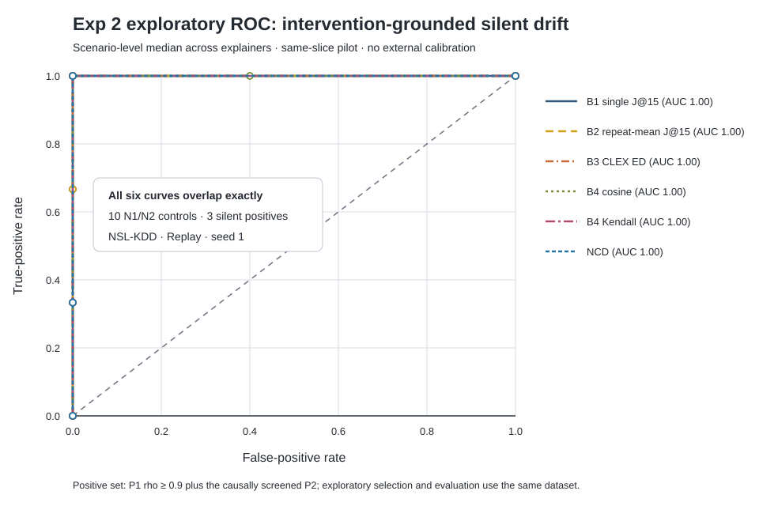

# Exp 2 v2 intervention-ground-truth result

## What ran

NSL-KDD, Replay, seed 1, transition 0→1. P1 used Normal-class shortcut strengths ρ ∈ {0.5, 0.7, 0.9, 1.0}. P2 used the causally screened DoS features `src_bytes`, `flag_RSTR`, and `dst_host_rerror_rate`; the original replay was retained and 1,600 zero-masked copies were appended. Every scenario included N1, exact-logit N2, three explainers, 10 repeats, 10 probe bootstraps, 1,000 permutations, B1–B4, NCD, and the declared ablations.

- Code commit: `bcec257257015d6c835eb6173761f13b116a0fda`
- Command: `python -I -B ncd/groundtruth.py --config ncd/configs/exp2_v2_nsl_replay_seed1.json`
- Full log: retained in the private research repository and omitted here because it contains local execution paths
- Runtime: 430.8 seconds on CUDA

## Results

| Scenario | Intervention effect change | Recall change | True change | Silent | NCD | B2 |
|---|---:|---:|:---:|:---:|:---:|:---:|
| P1 ρ=0.5 | 4.10 pp | −8.09 pp | no | no | yes | yes |
| P1 ρ=0.7 | 5.99 pp | −5.66 pp | yes | no | yes | yes |
| P1 ρ=0.9 | 11.34 pp | −2.73 pp | yes | yes | yes | yes |
| P1 ρ=1.0 | 48.19 pp | +0.13 pp | yes | yes | yes | yes |
| P2 DoS top-3 | 10.29 pp | −1.61 pp | yes | yes | yes | yes |

| Declared check | NCD | B2 repeat mean | Decision |
|---|---:|---:|---|
| N1/N2 false positives | 0/10 (0%) | 0/10 (0%) | NCD meets the ≤5% criterion |
| Strong silent P1 positives | 2/2 (100%) | 2/2 (100%) | NCD ties B2 |
| Silent P2 positives | 1/1 (100%) | 1/1 (100%) | NCD ties B2 |
| N2 max absolute logit difference | 0 | n/a | meets `<1e-5` |

All six continuous scores—B1, B2, adapted CLEX ED, cosine, Kendall, and NCD—have scenario-level AUROC 1.00 on 10 negative controls versus three silent positives. Their ROC curves overlap exactly. Removing probe bootstrap reduces strong-P1 NCD TPR from 100% to 50%; removing explanation repeats or FDR changes neither FPR nor strong-P1 TPR in this slice.

## Decision

The declared Exp 2 seed-1 criterion is met: NCD FPR is 0% and its strong-P1 TPR is not below B2. The new P2 provides one intervention-grounded silent positive. However, this does **not** establish NCD superiority or substantive innovation: B2 ties it, every continuous comparator also separates this tiny slice, and P2 construction was chosen in an exploratory screen using the same dataset. The next defensible step is a frozen multi-seed replication with construction selection separated from evaluation; if B2 remains tied, the manuscript must frame repeated averaging—not NCD—as sufficient for this benchmark.

## Evidence hashes

| Artifact | SHA-256 |
|---|---|
| `exp2_groundtruth_result.json` | `bf90525786eb6abe28e08aa0f7e74557e8944f7b6ebbfd2476917d35de533e13` |
| `exp2_groundtruth_table.csv` | `30214eecb516206027749ebc43cacd5aa3f18da46b23c9fe7608d4118a1c3958` |
| `exp2_groundtruth_consensus.csv` | `048a0149064d74efd4e31e4fc41b7e5d70cc3203ec03b3f2d8fba31ae9579276` |
| `exp2_groundtruth_discrimination.csv` | `3c10476eb2d43031f4f0db36bc7e36a45c46d96ef5a3c32daaf0fd619a5f9488` |
| `exp2_groundtruth_compact.npz` | `0a405283a3b6523f2f753d80a75b58f19b301b62a23e5f8e6c16bc6dc106a90b` |
| `exp2_roc.svg` | `d919622a26772e1773ce16606abda5fbf3cc9aee03304a7865aeca750dc2898a` |
| `exp2_roc.png` | `f31d3e996fb699a6b03d4e6b11095a103d928232f0dd1e9faeac5be0ae4deb82` |
| Private full log | `ba1653c997ae75cdffa2f478655714d9635e52aaa2b8a504ef0de9b5ff1e22d9` |
